# Agent Progress Digest

Concise chat progress updates: one factual sentence, then a TODO checklist. Unfinished work comes first; completed work stays visible.

This is a reporting skill, not a task runner, permission system, dashboard, or persistent bot configuration tool. It does not require a dedicated task tool.

## See the format



Illustrative Grok Bot-style UI reconstruction, not live model output or a product recording. The three-panel mock places the TODO digest inside assistant chat bubbles. On narrow SVG viewports, the illustration focuses on the chat; full desktop context remains in the wide view. The 15-second SVG loop includes a gentle zoom in and out. Reduced-motion viewers get the first snapshot; a [static version](assets/progress-digest-static.svg) is also available. Animation depends on the GitHub image viewer and browser; visual playback has not been verified on GitHub.

## Install

```bash
npx skills add AFK-agent-team/agent-progress-digest --skill agent-progress-digest
```

The repository shorthand and `--skill` selector were checked against `skills@1.9.0 add --help`. Remote discovery must be verified after publication. Your skills CLI controls installation scope and supported agents.

## Ask for an update

“Use Agent Progress Digest for milestone updates.”

Use the conversation language. Keep commands, filenames, and proper names unchanged.

## Before and after

Fictional input facts: page content was checked; mobile testing has not run; nothing was published.

Before (an intentionally poor report):

```text
Task id=17: 内容检查 completed
Task id=18: 移动端测试 pending
Task id=19: 发布 pending
```

After (same facts, no extra claims):

```text
页面内容已核对，移动端测试和发布尚未执行。
[ ] 检查移动端布局
[ ] 发布页面
[x] 核对页面内容
```

Blocked or unverified tasks stay unchecked. Put necessary blocker context in the lead sentence, not beside task titles. Single-step answers need no invented checklist. No Page or separate board is created.

## Deterministic SVG playback and review

Node.js 18+; no third-party runtime dependencies, DOM, network, clock, or randomness. The original UI reconstruction is a small string template; both frame exports and the README animation are generated from `src/progress-digest.mjs`.

```js
import { f, debug_view } from './src/progress-digest.mjs';
const svg = f(7.5); // standalone SVG string; same input gives the same bytes
const review = debug_view(7.5); // scene, camera, lead, tasks, normalized time
const mobile = f(7.5, { width: 390 });
const still = f(7.5, { reducedMotion: true }); // meaningful first frame
```

```bash
node scripts/render.mjs --time 7.5 --out-dir frames
node scripts/render.mjs --time 10 --width 390 --out-dir frames
node scripts/render.mjs --sample --out-dir frames
node scripts/render.mjs --build
node scripts/render.mjs --check
```

The CLI writes paired SVG + JSON files; `--sample` covers 15 boundary/interior times at both 1280 and 390 widths. `--build` regenerates the two committed README SVGs; `--check` detects drift. For a PNG contact sheet, render those SVGs with a static SVG renderer; no browser or video recording is required.

Time is nonnegative finite seconds, looping modulo 15. Scenes switch exactly at 5 and 10 seconds; 15 resets to the first frame. Invalid times and nonpositive/nonfinite widths throw. Camera interpolation is linear between shared keyframes; scene transitions are discrete, without empty crossfade gaps. Reduced motion freezes the first frame. Narrow exports focus on chat and disable camera movement.

Seek by calling `f(targetSeconds)`. Pause by keeping that time constant; playback speed is the caller's time multiplier (`f(positionSeconds * rate)`). This is a deterministic frame API, not a recorder or media player. `debug_view(t)` describes exactly the illustrative state used by `f(t)`; it is not production task telemetry. Browser CSS animation and image-context responsive behavior still need browser playback verification; static samples do not prove those behaviors.

## Verify

```bash
python3 scripts/verify.py
```

The script checks package structure, frontmatter, examples, and common accidental sensitive-content patterns. It is a static check, not proof of model compliance or a complete secret scanner. Functional prompts live in `evals/evals.json`.

## License and origin

MIT. This release contains newly written explanatory prose and test fixtures based on a user-requested reporting format. It does not bundle third-party helper code, platform-specific configuration instructions, private bot profiles, or credentials. The existing local `add-chat-digest` skill is not renamed or modified by this release.
